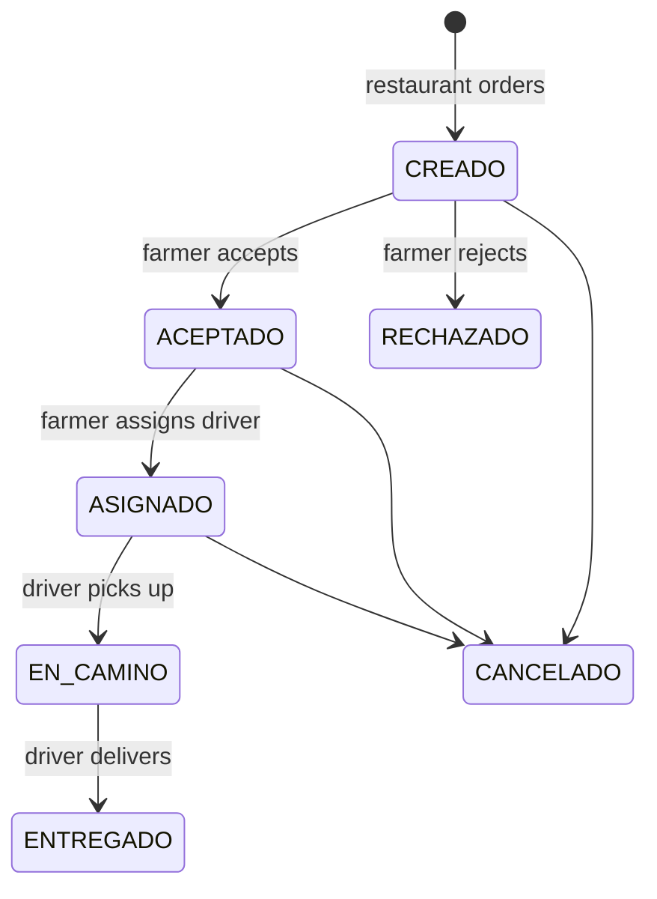
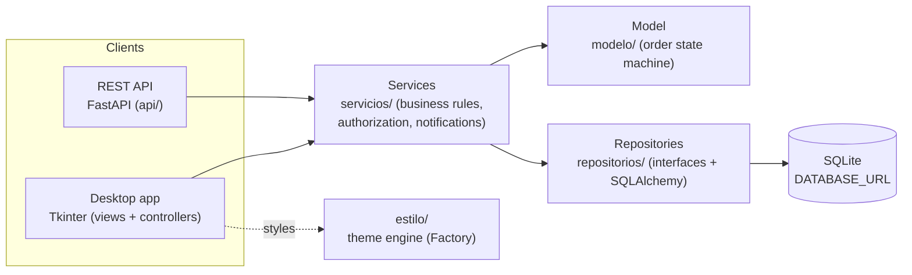

# 🌱 AgroConecta

[Versión en español](readme.md)

A platform that connects **farmers**, **restaurants** and **delivery drivers** so small producers can sell directly, with full traceability of every order. It ships a **desktop app (Python/Tkinter)** with 9 visual themes and a **REST API (FastAPI)**, both sharing the same business logic and a **SQLite** database (no Docker, no servers).

## The problem

Many farmers have no direct access to buyers and sell through intermediaries who keep a large share of the price. Restaurants, in turn, don't know what is available or where it comes from. AgroConecta puts producers in front of buyers: the farmer publishes inventory, the restaurant orders, and a driver delivers, with a history and a QR code that tell what happened to each order.

## Roles and order flow

| Role | What they do |
|---|---|
| **Farmer** | Manages inventory (crops, quantities, prices), accepts or rejects orders and assigns a driver. |
| **Restaurant** | Browses farmers with stock, places orders, checks history and QR, gets a `.txt` invoice. |
| **Delivery driver** | Receives assigned orders and marks them *on the way* and *delivered*. |
| **Admin** | Creates and edits roles and permissions and assigns them to users. |



Every transition is recorded in the order **history** and notifies the parties involved. Rejecting or cancelling returns the stock to the farmer.

> 🎬 **Order flow GIF**  
> `` ← _to be recorded_

## Features

- Sign-up and login with **bcrypt** passwords (automatic migration from legacy SHA-256 hashes).
- Farmer inventory and a farmer catalog for restaurants.
- Orders with a validated state machine, event history, **QR code** and concurrency control (two clients can't override the same transition).
- Per-user notifications.
- **Dynamic roles and permissions**: created and edited from the admin UI (or the API) and applied instantly.
- `.txt` invoices.
- **Visual theme engine** (9 skins) in the desktop app.
- REST API with JWT and automatic documentation.

## 🎨 Skin engine

The `estilo/` package is a theme engine built on the **Factory** pattern (`EstiloFactory`): each theme is a color class and the whole UI paints itself by asking the active style, so switching themes touches no view. There are 9 themes: Dark, Light, Green, Blue, Black & White, Red, Pink, Wine and Magenta.

| Dark | Light | Green |
|:--:|:--:|:--:|
|  |  |  |

| Blue | Wine | Magenta |
|:--:|:--:|:--:|
|  |  |  |

_(Screenshots pending: put them in `docs/img/`.)_

## Stack

Python 3.12+ · Tkinter · SQLAlchemy 2.x · SQLite (WAL) · FastAPI + Uvicorn · PyJWT · bcrypt · qrcode/Pillow · pytest.

## Architecture



## Design decisions

- **Strategy for notifications** (`notificaciones/notification_stratgies.py`): each event type defines how it formats its message; the service just delivers it.
- **Factory in the theme engine** (`estilo/estiloFactory.py`): builds the theme from the saved configuration.
- **Repository pattern** (`repositorios/`): one interface per entity plus a SQLAlchemy implementation. Nothing outside that layer knows the ORM; switching databases only requires changing `DATABASE_URL`.
- **UI-free services**: business logic lives in `servicios/` with no dependency on Tkinter or FastAPI; both clients call the same code.
- **Dynamic roles and permissions**: a user's permissions are **derived from their roles** (`rol_permisos`), never stored twice; editing a role instantly changes what its users can do. System roles and permissions are protected.
- **Traceability**: each order keeps its events in `pedido_eventos` and a retrievable QR.
- **Concurrency**: stock deduction is a conditional `UPDATE` and state transitions use optimistic checks.

## Running it

```bash
python3 -m venv venv
source venv/bin/activate            # Windows: venv\Scripts\activate
pip install -r requirements.txt
cp .env.example .env                # optional; set JWT_SECRET for the API

python scripts/seed_demo.py         # demo data (optional, idempotent)
python main.py                      # desktop app (needs Tkinter)
uvicorn api.main:app --reload       # API at http://127.0.0.1:8000  ·  docs at /docs
```

The database is created automatically at `data/agroconecta.db`. Set `DATABASE_URL` in `.env` to use another one.

**Demo accounts** (local testing only):

| Role | Email | Password |
|---|---|---|
| Admin | `ADMIN` | `ADMIN` |
| Farmer | `campesino@demo.com` | `Campesino123!` |
| Restaurant | `restaurante@demo.com` | `Restaurante123!` |
| Driver | `domiciliario@demo.com` | `Domiciliario123!` |

> Coming from the previous MongoDB version? `pip install -r requirements-migracion.txt` and `MONGO_URI=... python scripts/migrar_desde_mongo.py` copies your data to SQLite.

## Tests

```bash
pip install -r requirements-dev.txt
pytest
```

They use in-memory SQLite (no servers, no windows): order model and states, repositories, authentication (including legacy hash migration), permissions, dynamic roles, notifications, services and the API (`TestClient`).

## API examples

```bash
# Sign up and log in
curl -X POST localhost:8000/auth/registro -H 'Content-Type: application/json' -d '{
  "tipo":"restaurante","nombre":"El Surco","email":"surco@mail.com",
  "password":"Clave123!","telefono":"3004445566","nit":"900123456-7"}'

TOKEN=$(curl -s -X POST localhost:8000/auth/login -H 'Content-Type: application/json' \
  -d '{"email":"restaurante@demo.com","password":"Restaurante123!"}' | python -c "import sys,json;print(json.load(sys.stdin)['access_token'])")

# Browse farmers with stock and create an order
curl localhost:8000/campesinos -H "Authorization: Bearer $TOKEN"
curl -X POST localhost:8000/pedidos -H "Authorization: Bearer $TOKEN" -H 'Content-Type: application/json' \
  -d '{"email_campesino":"campesino@demo.com","cultivo":"tomate","cantidad":5}'

# Order history and QR
curl localhost:8000/pedidos/PED-XXXX/historial -H "Authorization: Bearer $TOKEN"
curl localhost:8000/pedidos/PED-XXXX/qr -H "Authorization: Bearer $TOKEN" -o qr.png

# As the farmer: accept and assign a driver; as the driver: advance the state
curl -X POST localhost:8000/pedidos/PED-XXXX/aceptar -H "Authorization: Bearer $FARMER_TOKEN"
curl -X POST localhost:8000/pedidos/PED-XXXX/asignar -H "Authorization: Bearer $FARMER_TOKEN" \
  -H 'Content-Type: application/json' -d '{"email_delivery":"domiciliario@demo.com"}'
curl -X POST localhost:8000/pedidos/PED-XXXX/estado -H "Authorization: Bearer $DRIVER_TOKEN" \
  -H 'Content-Type: application/json' -d '{"estado":"EN_CAMINO"}'
```

| Area | Endpoints |
|---|---|
| Auth | `POST /auth/registro` · `POST /auth/login` · `GET /auth/me` |
| Inventory | `GET/POST /cultivos` · `DELETE /cultivos/{name}` · `GET /campesinos` · `GET /campesinos/{email}/inventario` |
| Orders | `POST/GET /pedidos` · `GET /pedidos/{id}` · `/historial` · `/qr` · `POST /aceptar` · `/asignar` · `/estado` · `/cancelar` |
| Notifications | `GET /notificaciones` · `POST /notificaciones/leer` |
| Admin | `/admin/roles` · `/admin/roles/{id}/permisos` · `/admin/permisos/{id}` · `/admin/usuarios` |

Clear errors: `401` no token, `403` missing permission or not part of the order, `404`, `409` (invalid state, insufficient stock, duplicates) and `422` (validation), all as `{"detail": "...", "codigo": "..."}`.

## Project layout

```
main.py                 desktop app
api/                    FastAPI API (routers, schemas, JWT, dependencies)
servicios/              business logic (no Tkinter, no FastAPI)
modelo/                 order rules, invoices, data facades
repositorios/           interfaces + SQLAlchemy implementation, ORM, connection
controlador/ vistas/    Tkinter MVC layer
notificaciones/         notification service and strategies
auth/                   hashing, validation and permissions
estilo/                 theme engine
scripts/                seed_demo.py, migrar_desde_mongo.py (optional), encriptarJSON.py
tests/                  pytest
docs/img/               screenshots and GIF
```

## Future work

- Move to **PostgreSQL** (code only depends on `DATABASE_URL`; add Alembic).
- **Mobile app** consuming this API.
- Online **payments**.
- Move the remaining Tkinter admin screens to the services.
- Real-time notifications (WebSocket) and delivery geolocation.

## Notes

- Set `JWT_SECRET` in `.env` for the API; otherwise a temporary secret is used and tokens are invalidated on restart.
- The Tkinter role-administration screens still call `modelo/` (not `servicios/`); the API and the rest of the app use the services.
- Demo credentials are for local testing only.

## License

[MIT](LICENSE)
