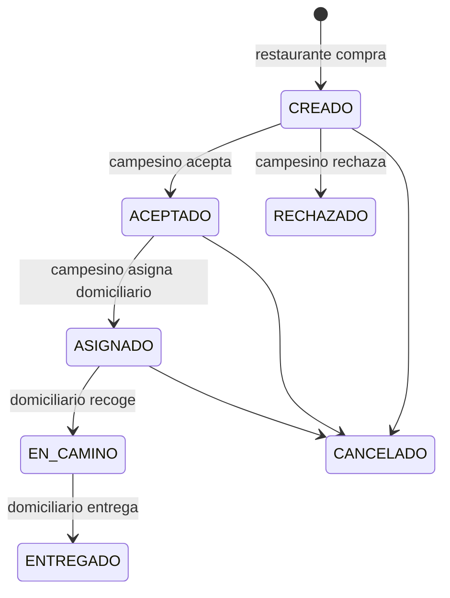
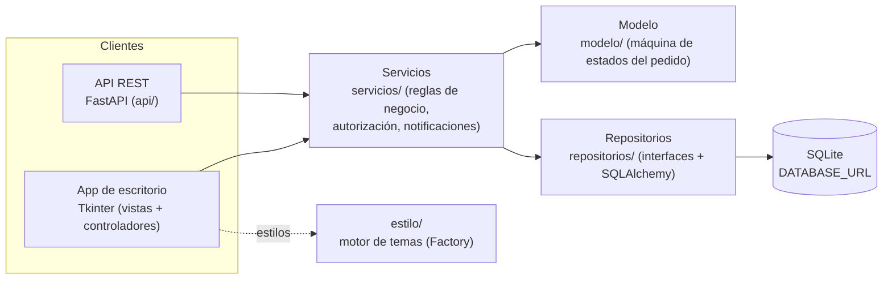

# 🌱 AgroConecta

[English version](readme.en.md)

Plataforma que conecta **campesinos**, **restaurantes** y **domiciliarios** para que los pequeños productores vendan directamente, con trazabilidad completa de cada pedido. Incluye una **app de escritorio (Python/Tkinter)** con 9 temas visuales y una **API REST (FastAPI)**, ambas sobre la misma lógica de negocio y una base **SQLite** (sin Docker ni servidores).

## El problema

Muchos campesinos no tienen acceso directo a los compradores y venden a través de intermediarios que se quedan con gran parte del precio. Los restaurantes, por su parte, no saben qué hay disponible ni de dónde viene. AgroConecta pone al productor frente al comprador: el campesino publica su inventario, el restaurante compra y un domiciliario entrega, con historial y QR que permiten saber qué pasó con cada pedido.

## Roles y flujo de un pedido

| Rol | Qué hace |
|---|---|
| **Campesino** | Administra su inventario (cultivos, cantidades, precios), acepta o rechaza pedidos y asigna domiciliario. |
| **Restaurante** | Ve campesinos con stock, hace pedidos, consulta historial y QR, descarga la factura (.txt). |
| **Domiciliario** | Recibe pedidos asignados, los marca *en camino* y *entregados*. |
| **Admin** | Crea y edita roles y permisos y los asigna a usuarios. |



Cada transición queda en el **historial** del pedido y notifica a las partes. Al rechazar o cancelar, el stock vuelve al inventario del campesino.

> 🎬 **GIF del flujo de un pedido**  
> `` ← _pendiente de grabar_

## Funcionalidades

- Registro e inicio de sesión con contraseñas **bcrypt** (migración automática desde hashes SHA-256 antiguos).
- Inventario del campesino y catálogo de campesinos para el restaurante.
- Pedidos con máquina de estados validada, historial de eventos, **código QR** y control de concurrencia (dos clientes no pueden pisar la misma transición).
- Notificaciones por usuario.
- **Roles y permisos dinámicos**: se crean y editan desde la interfaz de admin (o la API) y se aplican al instante.
- Facturas en `.txt`.
- **Motor de temas visuales** (9 skins) en la app de escritorio.
- API REST con JWT y documentación automática.

## 🎨 Motor de skins

El paquete `estilo/` implementa un motor de temas con el patrón **Factory** (`EstiloFactory`): cada tema es una clase de colores y toda la interfaz se pinta consultando al estilo activo, así que cambiar de tema no toca ninguna vista. Hay 9 temas: Oscuro, Claro, Verde, Azul, Blanco y Negro, Rojo, Rosa, Vino tinto y Magenta.

| Oscuro | Claro | Verde |
|:--:|:--:|:--:|
|  |  |  |

| Azul | Vino tinto | Magenta |
|:--:|:--:|:--:|
|  |  |  |

_(Capturas pendientes: guárdalas en `docs/img/`.)_

## Stack

Python 3.12+ · Tkinter · SQLAlchemy 2.x · SQLite (WAL) · FastAPI + Uvicorn · PyJWT · bcrypt · qrcode/Pillow · pytest.

## Arquitectura



## Decisiones de diseño

- **Strategy en notificaciones** (`notificaciones/notification_stratgies.py`): cada tipo de evento define cómo formatea su mensaje (`NewOrderNotificationStrategy`, `OrderStatusChangedStrategy`); el servicio solo lo entrega.
- **Factory en el motor de temas** (`estilo/estiloFactory.py`): crea el tema según la configuración guardada.
- **Patrón Repository** (`repositorios/`): una interfaz por entidad y una implementación SQLAlchemy. Nadie fuera de esa capa conoce el ORM; para cambiar de motor basta con cambiar `DATABASE_URL`.
- **Servicios sin interfaz**: la lógica vive en `servicios/` sin depender de Tkinter ni FastAPI; ambos clientes llaman a lo mismo.
- **Roles y permisos dinámicos**: los permisos de un usuario **se derivan de sus roles** (`rol_permisos`), no se guardan duplicados; editar un rol cambia al instante lo que pueden hacer sus usuarios. Los roles y permisos del sistema están protegidos.
- **Trazabilidad**: cada pedido guarda sus eventos en `pedido_eventos` y un QR consultable.
- **Concurrencia**: el descuento de stock es un `UPDATE` condicional y las transiciones de estado usan control optimista.

## Cómo correrlo

```bash
python3 -m venv venv
source venv/bin/activate            # Windows: venv\Scripts\activate
pip install -r requirements.txt
cp .env.example .env                # opcional; define JWT_SECRET para la API

python scripts/seed_demo.py         # datos de demo (opcional, idempotente)
python main.py                      # app de escritorio (requiere Tkinter)
uvicorn api.main:app --reload       # API en http://127.0.0.1:8000  ·  docs en /docs
```

La base se crea sola en `data/agroconecta.db`. Para usar otra, define `DATABASE_URL` en `.env`.

**Cuentas de demo** (solo para pruebas locales):

| Rol | Email | Contraseña |
|---|---|---|
| Admin | `ADMIN` | `ADMIN` |
| Campesino | `campesino@demo.com` | `Campesino123!` |
| Restaurante | `restaurante@demo.com` | `Restaurante123!` |
| Domiciliario | `domiciliario@demo.com` | `Domiciliario123!` |

> Si vienes de la versión anterior con MongoDB: `pip install -r requirements-migracion.txt` y `MONGO_URI=... python scripts/migrar_desde_mongo.py` copia tus datos a SQLite.

## Pruebas

```bash
pip install -r requirements-dev.txt
pytest
```

Usan SQLite en memoria (sin servidores ni ventanas): modelo y estados del pedido, repositorios, autenticación (incluida la migración de hash legado), permisos, roles dinámicos, notificaciones, servicios y API (`TestClient`).

## Ejemplos de la API

```bash
# Registro e inicio de sesión
curl -X POST localhost:8000/auth/registro -H 'Content-Type: application/json' -d '{
  "tipo":"restaurante","nombre":"El Surco","email":"surco@mail.com",
  "password":"Clave123!","telefono":"3004445566","nit":"900123456-7"}'

TOKEN=$(curl -s -X POST localhost:8000/auth/login -H 'Content-Type: application/json' \
  -d '{"email":"restaurante@demo.com","password":"Restaurante123!"}' | python -c "import sys,json;print(json.load(sys.stdin)['access_token'])")

# Ver campesinos con stock y crear un pedido
curl localhost:8000/campesinos -H "Authorization: Bearer $TOKEN"
curl -X POST localhost:8000/pedidos -H "Authorization: Bearer $TOKEN" -H 'Content-Type: application/json' \
  -d '{"email_campesino":"campesino@demo.com","cultivo":"tomate","cantidad":5}'

# Historial y QR de un pedido
curl localhost:8000/pedidos/PED-XXXX/historial -H "Authorization: Bearer $TOKEN"
curl localhost:8000/pedidos/PED-XXXX/qr -H "Authorization: Bearer $TOKEN" -o qr.png

# Como campesino: aceptar y asignar domiciliario; como domiciliario: avanzar el estado
curl -X POST localhost:8000/pedidos/PED-XXXX/aceptar -H "Authorization: Bearer $TOKEN_CAMPESINO"
curl -X POST localhost:8000/pedidos/PED-XXXX/asignar -H "Authorization: Bearer $TOKEN_CAMPESINO" \
  -H 'Content-Type: application/json' -d '{"email_delivery":"domiciliario@demo.com"}'
curl -X POST localhost:8000/pedidos/PED-XXXX/estado -H "Authorization: Bearer $TOKEN_DOMI" \
  -H 'Content-Type: application/json' -d '{"estado":"EN_CAMINO"}'
```

| Área | Endpoints |
|---|---|
| Auth | `POST /auth/registro` · `POST /auth/login` · `GET /auth/me` |
| Inventario | `GET/POST /cultivos` · `DELETE /cultivos/{nombre}` · `GET /campesinos` · `GET /campesinos/{email}/inventario` |
| Pedidos | `POST/GET /pedidos` · `GET /pedidos/{id}` · `/historial` · `/qr` · `POST /aceptar` · `/asignar` · `/estado` · `/cancelar` |
| Notificaciones | `GET /notificaciones` · `POST /notificaciones/leer` |
| Admin | `/admin/roles` · `/admin/roles/{id}/permisos` · `/admin/permisos/{id}` · `/admin/usuarios` |

Errores claros: `401` sin token, `403` sin permiso o sin ser parte del pedido, `404`, `409` (estado inválido, stock insuficiente, duplicados) y `422` (validación), todos con `{"detail": "...", "codigo": "..."}`.

## Estructura

```
main.py                 app de escritorio
api/                    API FastAPI (routers, esquemas, JWT, dependencias)
servicios/              lógica de negocio (sin Tkinter ni FastAPI)
modelo/                 reglas del pedido, facturas, fachadas de datos
repositorios/           interfaces + implementación SQLAlchemy, ORM, conexión
controlador/ vistas/    capa MVC de Tkinter
notificaciones/         servicio y estrategias de notificación
auth/                   hashing, validaciones y permisos
estilo/                 motor de temas
scripts/                seed_demo.py, migrar_desde_mongo.py (opcional), encriptarJSON.py
tests/                  pytest
docs/img/               capturas y GIF
```

## Mejoras futuras

- Migrar a **PostgreSQL** (el código ya solo depende de `DATABASE_URL`; añadir Alembic).
- **App móvil** consumiendo esta API.
- **Pagos** en línea.
- Migrar el resto de pantallas de administración de Tkinter a los servicios.
- Notificaciones en tiempo real (WebSocket) y geolocalización de entregas.

## Licencia

[MIT](LICENSE)
